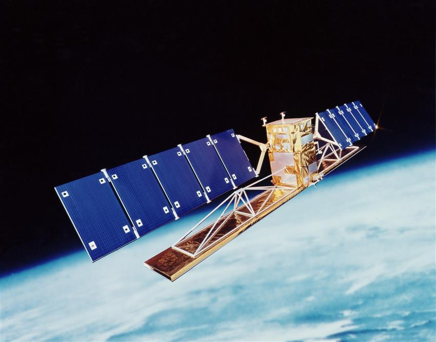

<p align="center">
    <a href="https://www.asc-csa.gc.ca/eng/satellites/radarsat/">
        
    </a>
    <br> Crédit d'image | Image credit: <a href="https://www.asc-csa.gc.ca/eng/satellites/radarsat/">ASC-CSA</a>
</p>

<p align="center">
    <a href="#stars">
        
    </a>
    <a href="#watchers">
        
    </a>
    <a href="https://github.com/asc-csa/EO-Visualization-and-Search-Tutorial/commits/main">
        
    </a>
    <a href="https://github.com/asc-csa/EO-Visualization-and-Search-Tutorial/graphs/contributors">
        
    </a>
    <a href="https://twitter.com/intent/follow?screen_name=csa_asc">
        
    </a>
</p>

---

<h3 align="center">
  <a href="#titre-du-projet">Français</a> |
  <a href="#project-title">English (follows)</a>
</h3>

---

<a id="titre-du-projet"></a>
# Visualisation-et-la-Recherche-d'Images-OT - Tutoriel

> **Description brève :**
> Ce tutoriel présente l'utilisation du SGDOT et de son API REST pour rechercher et visualiser des images RADARSAT-1 et RCM.

## À propos

**Visualisation-et-la-Recherche-d'Images-OT - Tutoriel** est un tutoriel qui guide les utilisateurs dans l'utilisation du SGDOT et de son API REST pour rechercher et visualiser des images RADARSAT-1 et RCM. Il couvre :

- Recherche et téléchargement de données satellitaires via l'API REST du SGDOT
- Visualisation interactive d'images RADARSAT-1 et RCM sur des cartes
- Filtrage et sélection de données basées sur des critères géographiques et temporels
- Traitement et affichage de vastes ensembles de données d'observation de la Terre

RADARSAT-1 a fourni au Canada et au monde entier une plateforme avancée de radar à synthèse d'ouverture (SAR) capable d'acquérir des images de la Terre. La Mission Constellation RADARSAT (MCR) était la prochaine génération du programme RADARSAT, offrant une qualité, une quantité et une couverture améliorées de 90 % de la surface de la Terre.

La recherche et la distribution de ces images sont assurées par le système de gestion des données d'observation de la Terre (SGDOT) géré par Ressources naturelles Canada (RNCan). Les données disponibles par l'entremise du SGDOT sont vastes, car on s'attend à ce que le MCR prenne environ 250 000 images par année et que RADARSAT-1 capture plus de 710 000 images accessibles au public au cours de sa durée de vie.

*Ce tutoriel est fourni à des fins pédagogiques et expérimentales.*

## Prérequis

- Python 3.11 ou plus récent
- Jupyter Notebook ou Jupyter Lab
- Connexion Internet (pour l'accès à l'API SGDOT)
- Compte utilisateur SGDOT (optionnel pour certaines données)
- Environnement capable d'afficher des widgets interactifs

## Démarrage rapide

1. 📦 **Cloner le dépôt**
   ```bash
   git clone https://github.com/asc-csa/EO-Visualization-and-Search-Tutorial.git
   cd EO-Visualization-and-Search-Tutorial
   ```
2. 🐍 **Créer un environnement**
   ```bash
   # Avec virtualenv
   python -m venv env
   source env/bin/activate

   # Ou avec conda
   conda create -n eo_viz_env python=3.11
   conda activate eo_viz_env
   ```
3. 📥 **Installer les dépendances**
   ```bash
   pip install -r requirements.txt
   ```
4. 🚀 **Lancer le tutoriel**
   ```bash
   jupyter notebook
   ```

> **Remarque :** Si vous ne parvenez pas à afficher les widgets associés ou la carte ipyleaflet, il peut être nécessaire d'exécuter et/ou d'installer jupyter notebook dans le même noyau qui possède les paquets requis.

## Astuces & Conseils

- **Widgets interactifs :** Assurez-vous que jupyter widgets est correctement installé avec `jupyter nbextension enable --py widgetsnbextension`
- **API SGDOT :** Vérifiez votre connexion Internet pour l'accès aux données en temps réel
- **Performance :** Les requêtes API peuvent prendre du temps selon la taille des données demandées
- **Cartes :** Si les cartes ipyleaflet ne s'affichent pas, redémarrez le kernel Jupyter

## Licence

Ce projet est sous une licence MIT modifiée – voir le fichier [LICENSE](https://github.com/asc-csa/EO-Visualization-and-Search-Tutorial/blob/main/LICENSE.txt) pour plus de détails.

---

<h3 align="center">
  <a href="#project-title">English </a> |
  <a href="#titre-du-projet">Français (précède)</a>
</h3>

---

<a id="project-title"></a>
# EO-Visualization-and-Search-Tutorial

> **Brief description:**
> This tutorial demonstrates using EODMS and its REST API to search and display RADARSAT-1 and RCM imagery.

# EO-Visualization-and-Search-Tutorial

## About

**EO-Visualization-and-Search-Tutorial** is a tutorial that guides users through using EODMS and its REST API to search and visualize RADARSAT-1 and RCM imagery. It covers:

- Searching and downloading satellite data via the EODMS REST API
- Interactive visualization of RADARSAT-1 and RCM images on maps
- Filtering and selecting data based on geographic and temporal criteria
- Processing and displaying vast Earth observation datasets

RADARSAT-1 provided Canada and the world with an advanced synthetic aperture radar (SAR) platform capable of acquiring images of the Earth. The RADARSAT Constellation Mission (RCM) was the next generation of the RADARSAT Program, offering improved quality, quantity and coverage of 90% of Earth's surface.

The search and distribution of these images is provided by the Earth Observation Data Management System (EODMS) managed by Natural Resources Canada (NRCan). The available data through EODMS is vast, with RCM expected to take approximately 250,000 images per year, and RADARSAT-1 capturing over 710,000 publicly available images over its lifetime.

*This tutorial is provided for educational and experimental purposes.*

## Prerequisites

- Python 3.11 or newer
- Jupyter Notebook or Jupyter Lab
- Internet connection (for EODMS API access)
- EODMS user account (optional for some data)
- Environment capable of displaying interactive widgets

---


## Quick Start

1. 📦 **Clone the repo**
   ```bash
   git clone https://github.com/asc-csa/EO-Visualization-and-Search-Tutorial.git
   cd EO-Visualization-and-Search-Tutorial
   ```
2. 🐍 **Create environment**
   ```bash
   # Using virtualenv
   python -m venv env
   source env/bin/activate

   # Or using conda
   conda create -n eo_viz_env python=3.11
   conda activate eo_viz_env
   ```
3. 📥 **Install dependencies**
   ```bash
   pip install -r requirements.txt
   ```
4. 🚀 **Run the tutorial**
   ```bash
   jupyter notebook
   ```

> **Note:** If you are unable to display either the associated widgets or ipyleaflet map, it may be required to run and/or install jupyter notebook into the same kernel that has the required packages.

## Tips & Tricks

- **Interactive widgets:** Ensure jupyter widgets is properly installed with `jupyter nbextension enable --py widgetsnbextension`
- **EODMS API:** Check your internet connection for real-time data access
- **Performance:** API requests may take time depending on the size of requested data
- **Maps:** If ipyleaflet maps don't display, restart the Jupyter kernel

## License

This project is licensed under a modified MIT license - see the [LICENSE](https://github.com/asc-csa/EO-Visualization-and-Search-Tutorial/blob/main/LICENSE.txt) file for details.
